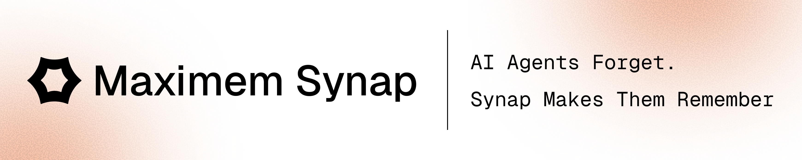
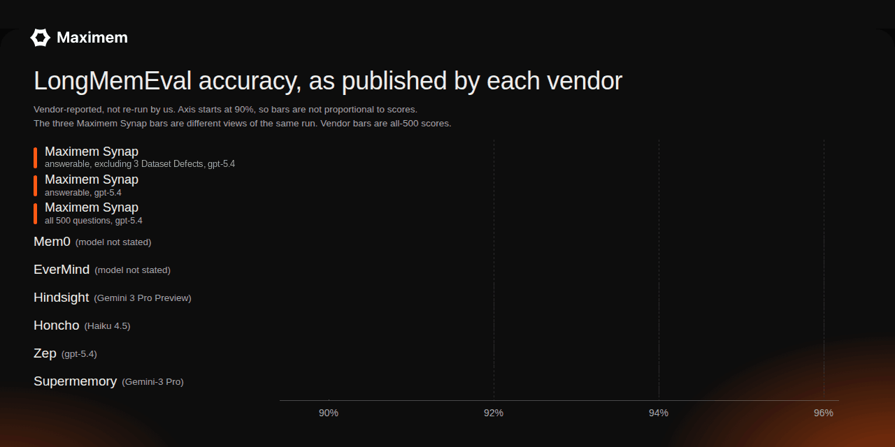
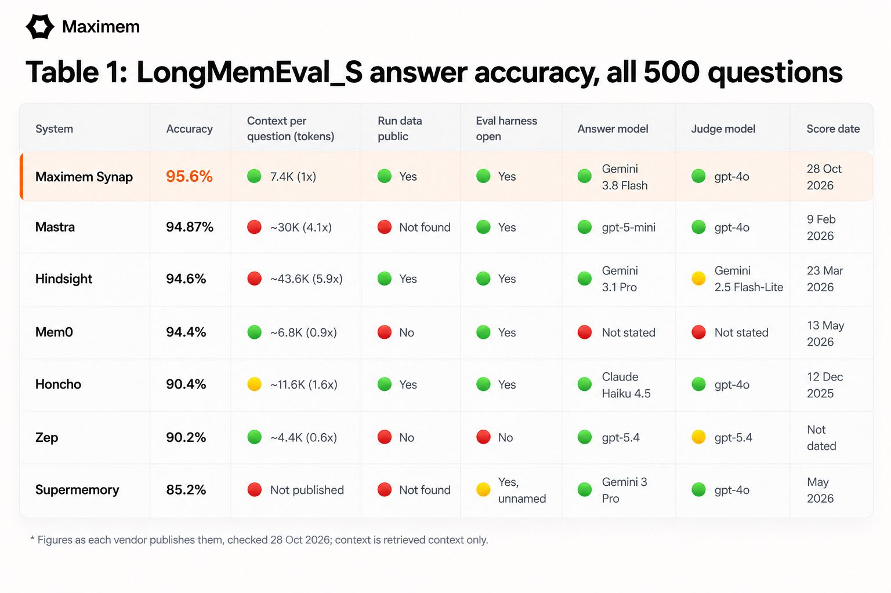

<p align="center">
  <picture>
    <source media="(prefers-color-scheme: dark)" srcset=".github/banner-dark.png">
    
  </picture>
</p>

<h3 align="center">Open, re-runnable memory benchmarks for Maximem Synap.</h3>

<p align="center">
  <a href="https://www.maximem.ai/synap"><b>Website</b></a> |
  <a href="https://docs.maximem.ai"><b>Docs</b></a> |
  <a href="https://github.com/maximem-ai/maximem_synap_sdk"><b>SDK</b></a> |
  <a href="https://github.com/maximem-ai/memory_and_context_eval_harness"><b>Eval harness</b></a> |
  <a href="RESULTS.md"><b>Full results</b></a> |
  <a href="METHODOLOGY.md"><b>Methodology</b></a>
</p>

<p align="center">
  <a href="RESULTS.md#longmemeval-overall-956"></a>
  <a href="RESULTS.md#longmemeval-answerable-questions-957"></a>
  <a href="RESULTS.md#longmemeval-retrieval-recall20-981"></a>
  <a href="RESULTS.md#locomo-overall-932-cat-1-4-adversarial-excluded"></a>
  <a href="METHODOLOGY.md"></a>
  <a href="METHODOLOGY.md"></a>
  <a href="https://github.com/maximem-ai/memory_and_context_eval_harness"></a>
  <a href="LICENSE"></a>
</p>

This repository publishes the benchmark results for [Maximem Synap](https://www.maximem.ai/synap), the memory layer for AI agents. It gives you the scores, how they were produced, and for LongMemEval every per-question record, so you can check the number instead of trusting it.

<p align="center">
  <picture>
    <source media="(prefers-reduced-motion: reduce)" srcset=".github/chart-static.png">
    
  </picture>
</p>

<p align="center">
  <picture>
    <source media="(prefers-color-scheme: dark)" srcset=".github/comparison-table-dark.png">
    
  </picture>
</p>

---

## Results

| Benchmark | Maximem Synap | Run date | Questions | Answer model / judge | What is published |
|---|:---:|---|---|---|---|
| **LongMemEval** (all 500 questions) | **95.6%** (478 / 500) | October 2026 | 500, variant `LongMemEval_S` | `gemini-3.8-flash` / `gpt-4o` | Every question: retrieved memories, answer and judge verdict ([data](results/longmemeval/question_records_gemini-3.8-flash.json)) |
| **LongMemEval** (answerable questions) | 95.7% (450 / 470) | October 2026 | 470 of the 500 (30 abstention questions excluded) | `gemini-3.8-flash` / `gpt-4o` | Same records |
| **LongMemEval retrieval** (Recall@20) | **98.1%** (461 / 470) | 2026-10-13 (retrieval), 2026-10-25 (relevance labels) | 470, abstention excluded | no answer model / `gpt-4o` relevance judge | Per-question relevance labels ([data](results/longmemeval/retrieval_relevance_gpt4o_top20.jsonl)) |
| **LoCoMo** | **93.2%** | 2026-06-20 | 1,540, Cat 1-4 (adversarial Cat 5 excluded, [why](METHODOLOGY.md#scope-decisions)) | `gpt-5-mini` / `gpt-5-mini` | Category scores ([RESULTS.md](RESULTS.md)) |

LongMemEval was run in October 2026. **In April our LongMemEval score was 92.0%. It is now 95.6% on all 500 questions and 95.7% on the 470 answerable questions.** The judge, `gpt-4o`, is the one LongMemEval's own evaluation script uses. Category breakdowns are [below](#results-by-category).

### Retrieval: Recall@20

Accuracy tells you whether the final answer was right. Recall@20 tells you whether the right evidence was retrieved. A question counts as a hit when GPT-4o judges at least one of the first 20 memories Maximem Synap retrieved as relevant to the question and its gold answer. Abstention questions have no evidence to retrieve, so they are excluded, which leaves 470 of the 500 questions. Maximem Synap scores **98.1% (461 / 470)**. The method follows the public [MemoryBench](https://github.com/supermemoryai/memorybench) relevance prompt.

### Evaluate your own agent

These are benchmark scores on standard datasets published by independent researchers. Maximem Synap can also evaluate memory performance on your own data, including a baseline for your existing agent. [Request a custom evaluation](https://docs.google.com/forms/d/e/1FAIpQLSeyTWs93X1aD3avdiY7B9ZtCJrMDNCs-PsDHpsAdCnXSSp3TQ/viewform?usp=dialog).

## Check the LongMemEval number yourself

The score comes straight from the published records. You need [`jq`](https://jqlang.github.io/jq/).

```bash
# Correct answers out of 500 (prints 478)
jq '[.[] | select(.judge.judge_raw | ascii_downcase | startswith("yes"))] | length' \
  results/longmemeval/question_records_gemini-3.8-flash.json

# Correct / total for each question type
jq -r 'group_by(.question_type)[] | "\(.[0].question_type)\t\([.[] | select(.judge.judge_raw | ascii_downcase | startswith("yes"))] | length) / \(length)"' \
  results/longmemeval/question_records_gemini-3.8-flash.json
```

A question counts as correct when the judge's reply starts with "yes". The verdicts are the judge model's output as recorded.

The answerable score comes from the same records:

```bash
# Answerable questions (abstention excluded): prints {"correct":450,"total":470}
jq -c '[.[] | select(.retrieval.abstention | not)] | {correct: (map(select(.judge.judge_raw | ascii_downcase | startswith("yes"))) | length), total: length}' \
  results/longmemeval/question_records_gemini-3.8-flash.json
```

Recall@20 comes from the published relevance labels:

```bash
# Hits out of the 470 non-abstention questions (prints {"questions":470,"hits":461})
jq -s -c '[.[] | select(.abstention | not)] | {questions: length, hits: (map(select(.recall_at_20 == 1)) | length)}' \
  results/longmemeval/retrieval_relevance_gpt4o_top20.jsonl
```

## What is in this repo

| Path | Contents |
|---|---|
| [`results/longmemeval/question_records_gemini-3.8-flash.json`](results/longmemeval/question_records_gemini-3.8-flash.json) | One record per LongMemEval question (500), latest run (answer model `gemini-3.8-flash`) |
| [`results/longmemeval/manifest_gemini-3.8-flash.json`](results/longmemeval/manifest_gemini-3.8-flash.json) | Dataset variant, models, run date and prompt settings for the latest run |
| [`results/longmemeval/question_records.json`](results/longmemeval/question_records.json) | The same 500 questions from an earlier run (answer model `gpt-5.4`) |
| [`results/longmemeval/manifest.json`](results/longmemeval/manifest.json) | Settings for the earlier run |
| [`results/longmemeval/LME_answering_prompt.md`](results/longmemeval/LME_answering_prompt.md) | The prompt the answer model received |
| [`results/longmemeval/retrieval_relevance_gpt4o_top20.jsonl`](results/longmemeval/retrieval_relevance_gpt4o_top20.jsonl) | GPT-4o relevance label (1 or 0) for each of the first 20 retrieved memories, per question |
| [`results/longmemeval/retrieval_relevance_gpt4o_top20.summary.json`](results/longmemeval/retrieval_relevance_gpt4o_top20.summary.json) | Recall@20 totals and per-category breakdown |
| [`RESULTS.md`](RESULTS.md) | Category-level breakdown |
| [`METHODOLOGY.md`](METHODOLOGY.md) | Models, scope decisions, why vendor scores differ |
| [`bench/README.md`](bench/README.md) | How to re-run with the harness |
| [`CITATION.cff`](CITATION.cff) | Citation metadata |

<details>
<summary><b>Record format</b></summary>

Each record in the `question_records` files has these fields:

| Field | Meaning |
|---|---|
| `question_id`, `question`, `question_type`, `answer` | The benchmark question and its gold answer. Ids ending in `_abs` are abstention questions |
| `retrieval.retrieved_context` | The memories Maximem Synap returned for the question, with scores, dates and source evidence |
| `retrieval.search_query_sent` | The query sent to Maximem Synap (the question text) |
| `answering.generated_answer` | The answer model's reply |
| `judge.judge_raw` | The judge's reply, "Yes" or "No" (spelling varies slightly) |
| `retrieval.abstention`, `judge.abstention` | Whether the question is an abstention question |

The harness left these fields empty or zero: `answer_system`, `judge_system`, `error`, `judge_prompt_tokens` and `judge_completion_tokens`. The timing and answer token fields describe the harness run, not Maximem Synap.

The question text, gold answers and chat excerpts in the `question_records` files come from LongMemEval and remain under its own licence.

</details>

---

## How Maximem Synap compares

The table lists each vendor's **own published** LongMemEval number next to the answer model it used.

| System | LongMemEval accuracy | Recall@20 | Answer model | Context tokens* | Source |
|---|:---:|:---:|---|:---:|---|
| **Maximem Synap** (all 500 questions) | **95.6%** | **98.1%** | `gemini-3.8-flash` | ~1x | This repo (full records published) |
| **Maximem Synap** (answerable questions) | 95.7% | same | `gemini-3.8-flash` | ~1x | This repo |
| Mastra | 94.87% | not published | `gpt-5-mini` | 4.1x | [mastra.ai/research/observational-memory](https://mastra.ai/research/observational-memory) (LongMemEval-S, `gpt-4o` judge) |
| Hindsight (Vectorize) | 94.6% | not published | Gemini 3 Pro Preview | ~6x | [agentmemorybenchmark.ai](https://agentmemorybenchmark.ai/dataset/longmemeval) (473 / 500 correct, Gemini answer and judge; the Dec 2025 paper reports 91.4% with Gemini 3 Pro Preview) |
| Mem0 | 94.4% | not published | not stated | ~1x | [docs.mem0.ai](https://docs.mem0.ai/core-concepts/memory-evaluation) (managed platform) |
| EverMind | 94.0% | not found | not stated | not found | [evermind.ai](https://evermind.ai/) (no method given on the page) |
| Honcho | 90.4% | not published | Claude Haiku 4.5 | 1.6x | [honcho.dev/evals](https://honcho.dev/evals/) (92.6% with Gemini 3 Pro) |
| Zep | 90.2% | not published | `gpt-5.4` | 0.6x | [getzep.com/research](https://www.getzep.com/research/) (earlier paper: 71.2% with `gpt-4o`) |
| Supermemory | 85.2% | 97% | Gemini-3 Pro | not published | [supermemory.ai/research](https://supermemory.ai/research/longmembench/) (accuracy is an earlier figure; its current page reports Recall@20 with aggregation) |
| Letta (MemGPT) | no first-party score found | not published | n/a | n/a | n/a |

\* Median number of context tokens provided, for a ~115K-token original context; x = ~7K.

\*\* Numbers for other vendors are vendor-reported and have not been verified by us. They report all 500 questions, so only the all-500 Maximem Synap row is like for like with them.

**Recall@20** is an LLM-judged retrieval hit rate, computed on the 470 non-abstention questions, so it is the same on both Maximem Synap rows: a question counts as a hit when GPT-4o judges at least one of the first 20 retrieved memories relevant to the question and its gold answer, with abstention questions excluded. Our figure uses the public [MemoryBench](https://github.com/supermemoryai/memorybench) relevance prompt, and Supermemory's 97% is its own Recall@20 with aggregation. "Not published" means the vendor's LongMemEval page reports no retrieval metric (checked 2026-10-27).

Answer models, judges and prompts differ between vendors, so read this as context, not a controlled comparison. Why scores differ: [METHODOLOGY.md](METHODOLOGY.md#why-vendor-scores-differ).

### Maximem Synap with other answer models

Runs with different answer models, all judged by `gpt-4o`.

| Answer model | All 500 | Answerable (470) |
|---|:---:|:---:|
| Gemini 3.8 Flash (headline) | **95.6%** (478) | 95.7% (450) |
| `gpt-5.4` | 95.2% (476) | 95.5% (449) |
| Gemini 4 Argon | 97.0% (485) | 96.8% (455) |

### LoCoMo

LoCoMo claims use different scopes, metrics and model stacks. The scope and metric column is included so that answer-accuracy results, retrieval results and differing question coverage are not treated as interchangeable.

| System | LoCoMo | Scope and metric | Answer model / judge | Source |
|---|:---:|---|---|---|
| **Maximem Synap** | **93.2%** | 1,540 questions; answer accuracy | `gpt-5-mini` / `gpt-5-mini` | This repo ([method](METHODOLOGY.md#our-configuration)) |
| Hindsight (Vectorize) | 92.0% | 1,540 questions (1,417 correct); answer accuracy | Gemini (version not stated) | [agentmemorybenchmark.ai](https://agentmemorybenchmark.ai/dataset/locomo) |
| Mem0 | 92.5% | 1,540 questions; answer accuracy | `gpt-4o` / `gpt-4o` | [mem0.ai/research](https://mem0.ai/research) |
| EverMind | 94.74% | Homepage claim; its detailed post separately reports 94.42% micro answer accuracy across 1,540 questions | not stated for the homepage figure | [evermind.ai](https://evermind.ai/) |
| Honcho | 89.9% | 1,540 questions; answer accuracy | Claude Haiku 4.5; other pipeline models disclosed by vendor | [honcho.dev/evals](https://honcho.dev/evals/) |
| Zep | 94.7% | 1,540 questions (1,459 correct); answer accuracy | `gpt-5.4` / `gpt-5.4` | [getzep.com/research](https://www.getzep.com/research/) |
| Supermemory | numeric result not published | Claims #1 on LoCoMo, but no numeric LoCoMo result is published | not stated | [supermemory.ai/research](https://supermemory.ai/research/) |
| Letta (MemGPT) | 74.0% | Answer accuracy; simple agent | `gpt-4o-mini` / judge not stated | [Letta research](https://www.letta.com/blog/benchmarking-ai-agent-memory/) |

\* Numbers for other vendors are vendor-reported and have not been verified by us.

**Answer accuracy** measures whether a system's generated answer is judged correct against the benchmark answer.

**Retrieval accuracy** measures whether the system retrieved evidence relevant to answering the question. A system can retrieve relevant evidence but still produce a wrong answer, or produce a right answer without retrieving the right evidence, so these are different metrics.

---

## Results by category

<details open>
<summary><b>LongMemEval: 95.6% all 500 questions, 95.7% answerable</b></summary>

**All 500 questions: 95.6% (478 / 500)**

| Category | Maximem Synap | Correct / n |
|---|:---:|:---:|
| temporal-reasoning | **97.7%** | 130 / 133 |
| knowledge-update | 97.4% | 76 / 78 |
| single-session-preference | 96.7% | 29 / 30 |
| single-session-assistant | 96.4% | 54 / 56 |
| single-session-user | 95.7% | 67 / 70 |
| multi-session | 91.7% | 122 / 133 |
| **Overall** | **95.6%** | **478 / 500** |

**Answerable questions (30 abstention questions excluded): 95.7% (450 / 470)**

| Category | Maximem Synap | Correct / n |
|---|:---:|:---:|
| temporal-reasoning | **97.6%** | 124 / 127 |
| knowledge-update | 97.2% | 70 / 72 |
| single-session-preference | 96.7% | 29 / 30 |
| single-session-assistant | 96.4% | 54 / 56 |
| single-session-user | 95.3% | 61 / 64 |
| multi-session | 92.6% | 112 / 121 |
| **Overall** | **95.7%** | **450 / 470** |

Multi-session is the one category where we have most headroom to improve.

**Recall@20 by category** (abstention excluded)

| Category | Recall@20 | Hits / questions |
|---|:---:|:---:|
| single-session-user | **100.0%** | 64 / 64 |
| knowledge-update | 98.6% | 71 / 72 |
| multi-session | 98.3% | 119 / 121 |
| single-session-assistant | 98.2% | 55 / 56 |
| temporal-reasoning | 96.9% | 123 / 127 |
| single-session-preference | 96.7% | 29 / 30 |
| **Overall** | **98.1%** | **461 / 470** |

</details>

<details>
<summary><b>LoCoMo: 93.2% (Cat 1-4, adversarial excluded)</b></summary>

| Category | Maximem Synap |
|---|:---:|
| Multi-hop | **97.3%** |
| Open-domain | **93.4%** |
| Temporal | 90.8% |
| Single-hop | 88.8% |
| **Overall** | **93.2%** |

Counts per category are in [RESULTS.md](RESULTS.md).

</details>

## Limits of these results

- These results reflect the performance Maximem Synap is built to deliver consistently. Run-to-run variance is not reported in this repository.
- Competitor scores are vendor-reported and not verified by us. They use different answer models, judges and prompts.
- The LongMemEval answering prompt is written for Maximem Synap's memory format. It is published, and other systems would need their own.

---

## Reproduce it

You need Python 3.10+, an `OPENAI_API_KEY`, and a Maximem Synap API key ([get one](https://www.maximem.ai/synap)).

```bash
git clone https://github.com/maximem-ai/memory_and_context_eval_harness.git
cd memory_and_context_eval_harness
pip install -e .
cp .env.example .env                       # add OPENAI_API_KEY and your Maximem Synap key
python scripts/download_datasets.py --variant s
python -m runner.server                    # dashboard at http://localhost:8766
```

In the dashboard, pick the Maximem Synap provider and set the orchestrator config to the models used for each benchmark: `gemini-3.8-flash` (answer) and `gpt-4o` (judge) for LongMemEval, `gpt-5-mini` for both on LoCoMo. Step-by-step notes and settings are in [bench/README.md](bench/README.md).

---

## About Maximem Synap

Maximem Synap is an agent memory and agentic context-management layer for production AI agents. It does three jobs:

- **[Capture what matters](https://docs.maximem.ai/capture/conversations).** Facts, preferences, episodes and events are extracted, and [entity resolution](https://docs.maximem.ai/concepts/entity-resolution) maps "John", "John Smith" and "my manager" to one record.
- **[Keep context lean](https://docs.maximem.ai/sdk/context-compaction).** [Context compaction](https://docs.maximem.ai/sdk/context-compaction) keeps cost flat as conversations grow, without losing signal.
- **[Recall before it is asked for](https://docs.maximem.ai/sdk/context-fetch).** Context is pre-fetched, with recall around 15ms at P50 in production, fast enough for a voice agent.

It supports [native multi-agent use](https://docs.maximem.ai/concepts/agent-topologies) and [scoped memory](https://docs.maximem.ai/concepts/scope-ladder) across client, customer, user and many more custom scopes. [Integrations](https://docs.maximem.ai/integrations/overview) are available for LangChain, LangGraph, LlamaIndex, CrewAI, AutoGen, Google ADK, OpenAI Agents, Pydantic AI and more.

### What is open, what is hosted

| | In this repo / open | Maximem Synap Cloud |
|---|---|---|
| Benchmark results and methodology | Yes (CC BY 4.0) | |
| [Eval harness](https://github.com/maximem-ai/memory_and_context_eval_harness) | Yes | |
| [Python and JS SDKs](https://github.com/maximem-ai/maximem_synap_sdk) | Yes | |
| Memory engine (ingestion, entity resolution, retrieval) | | Hosted, not open source |

Running Maximem Synap in the benchmark needs a Maximem Synap API key.

### Set up Maximem Synap with your coding agent

1. Sign in to the [Maximem Synap dashboard](https://synap.maximem.ai). Your workspace is created automatically and can be renamed there.
2. Copy the setup prompt shown in the dashboard and paste it into Claude Code, Codex, Cursor or another coding agent. The prompt securely pairs the agent using a one-time code, so you never need to paste an API key into chat.
3. The agent reviews your repository, drafts a use-case document, asks only the product questions it needs, creates the instance, installs the SDK and implements the integration.
4. It writes the generated key to `.env`, then verifies the setup by writing and recalling a first memory. The dashboard shows the onboarding checklist through completion.

See the [AI coding agent setup guide](https://docs.maximem.ai/integrations/ai-coding-agents) for the full flow.

---

## Cite this

Please cite the repository ([`CITATION.cff`](CITATION.cff)) and the benchmarks:

<details>
<summary>BibTeX</summary>

```bibtex
@inproceedings{wu2025longmemeval,
  title     = {LongMemEval: Benchmarking Chat Assistants on Long-Term Interactive Memory},
  author    = {Wu, Di and others},
  booktitle = {International Conference on Learning Representations (ICLR)},
  year      = {2025},
  eprint    = {2410.10813},
  archivePrefix = {arXiv}
}

@inproceedings{maharana2024locomo,
  title     = {Evaluating Very Long-Term Conversational Memory of LLM Agents},
  author    = {Maharana, Adyasha and others},
  booktitle = {Annual Meeting of the Association for Computational Linguistics (ACL)},
  year      = {2024},
  eprint    = {2402.17753},
  archivePrefix = {arXiv}
}
```

</details>

Found a problem with a number or a method? [Open an issue](../../issues/new/choose). We would rather fix it than have you doubt it.

<p align="center"><sub>Maintained by <a href="https://github.com/maximem-ai">Maximem</a>.</sub></p>
