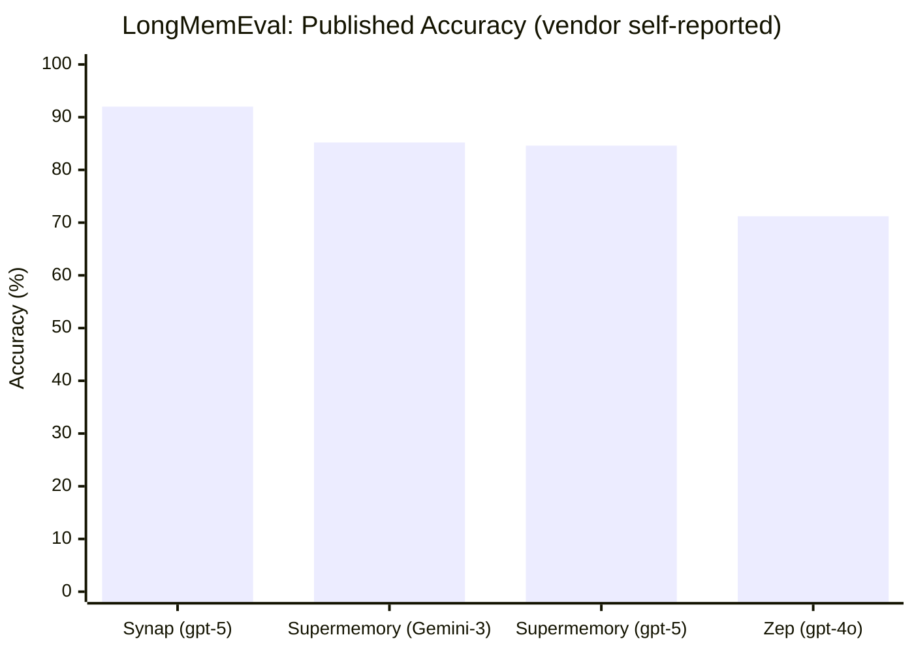

<div align="center">

# Synap: Agent Memory Benchmark Results

**Reproducible benchmark results for [Maximem Synap](https://github.com/maximem-ai/maximem_synap_sdk), the memory layer that makes AI agents remember.**

[](RESULTS.md#locomo-overall-932-cat-1-4-adversarial-excluded)
[](RESULTS.md#longmemeval-overall-920)
[](METHODOLOGY.md)
[](LICENSE)

</div>

---

## TL;DR

| Benchmark | Synap | Scope |
|---|:---:|---|
| **LoCoMo** | **93.2%** | Cat 1-4; adversarial (Cat 5) excluded, per [industry convention](METHODOLOGY.md#scope-decisions) |
| **LongMemEval** | **92.0%** | Full 500-question set |

Answer model `gpt-5`, LLM-as-judge `gpt-5-mini`. Full category-level breakdown lives in **[RESULTS.md](RESULTS.md)**; full methodology, models, and the variables that move scores across vendors are in **[METHODOLOGY.md](METHODOLOGY.md)**.

---

## How Synap compares

Memory benchmark scores are **highly sensitive to answer model, judge, ingestion granularity, and prompt**, so a fair comparison fixes those variables and cites every number. The table below lists each system's **own published LongMemEval accuracy** alongside the answer model it used (the single largest score driver).

| System | LongMemEval | Answer model | Source |
|---|:---:|---|---|
| **Synap** | **92.0%** | `gpt-5` | This repo |
| Supermemory | 85.2% | Gemini-3 Pro | [supermemory.ai/research](https://supermemory.ai/research) |
| Supermemory | 84.6% | `gpt-5` | [supermemory.ai/research](https://supermemory.ai/research) |
| Zep | 71.2% | `gpt-4o` | [arXiv:2501.13956](https://arxiv.org/abs/2501.13956) |
| Mem0 | *not published* | n/a | n/a |
| Letta (MemGPT) | *not published* | n/a | n/a |

> **Like-for-like:** on the same answer model (`gpt-5`), Synap's **92.0%** leads Supermemory's **84.6%** by **+7.4 points**. Mem0 and Letta have not published LongMemEval results; both Zep and Supermemory have [publicly called on Mem0](METHODOLOGY.md#the-vendor-landscape) to evaluate on it.



---

## Results by category

### LongMemEval: 92.0% (460 / 500)

| Category | Synap | Correct / n |
|---|:---:|:---:|
| single-session-user | **100.0%** | 70 / 70 |
| single-session-preference | **100.0%** | 30 / 30 |
| knowledge-update | **100.0%** | 78 / 78 |
| temporal-reasoning | **100.0%** | 133 / 133 |
| single-session-assistant | 87.5% | 49 / 56 |
| multi-session | 75.2% | 100 / 133 |
| **Overall** | **92.0%** | **460 / 500** |

### LoCoMo: 93.2% (Cat 1-4, adversarial excluded)

| Category | Synap |
|---|:---:|
| Multi-hop | **97.3%** |
| Open-domain | **93.4%** |
| Temporal | 90.8% |
| Single-hop | 88.8% |
| **Overall** | **93.2%** |

See **[RESULTS.md](RESULTS.md)** for the official-distribution counts behind each cell.

---

## Methodology in brief

- **Answer model:** `gpt-5`. **Judge:** binary CORRECT / WRONG, `gpt-5-mini`.
- **LongMemEval:** full 500-question set across 6 categories ([Wu et al., ICLR 2025](https://arxiv.org/abs/2410.10813)).
- **LoCoMo:** Cat 1-4 only; adversarial (Cat 5) excluded, matching the convention used by mem0, Zep, and the original LoCoMo paper ([Maharana et al., ACL 2024](https://arxiv.org/abs/2402.17753)).

Full details (datasets, scope decisions, and a side-by-side of *why vendor scores differ*: eval-LLM, judge, embedder, reranker, ingestion granularity, prompt, adversarial handling, run variance) are in **[METHODOLOGY.md](METHODOLOGY.md)**.

---

## Reproducibility

These results are produced with Maximem's open eval tooling against the **official public dataset distributions**, with no custom subsets or relabeling:

- **Harness:** [`maximem-ai/memory_and_context_eval_harness`](https://github.com/maximem-ai/memory_and_context_eval_harness)
- **Datasets:** LongMemEval (`LongMemEval_S`, 500 Q) and LoCoMo (`locomo10`), official releases.
- **Answer model:** `gpt-5`. **Judge model:** `gpt-5-mini` (binary CORRECT / WRONG).
- **Scope:** LongMemEval full set; LoCoMo Cat 1-4 (adversarial Cat 5 excluded).

Per-run artifacts (answers, retrieved context, judge verdicts) are maintained by the Maximem evaluation team and available on request.

---

## What's in this repo

| File | Contents |
|---|---|
| [`README.md`](README.md) | This overview: headlines, comparison, category tables. |
| [`RESULTS.md`](RESULTS.md) | Category-level breakdown with official-distribution counts. |
| [`METHODOLOGY.md`](METHODOLOGY.md) | Models, scope decisions, and the cross-vendor config comparison. |
| [`CITATION.cff`](CITATION.cff) | Machine-readable citation metadata. |

---

## Citing these results

If you reference these numbers, please cite the repository (see [`CITATION.cff`](CITATION.cff)) and the underlying benchmarks:

```bibtex
@inproceedings{wu2025longmemeval,
  title     = {LongMemEval: Benchmarking Chat Assistants on Long-Term Interactive Memory},
  author    = {Wu, Di and others},
  booktitle = {International Conference on Learning Representations (ICLR)},
  year      = {2025},
  eprint    = {2410.10813},
  archivePrefix = {arXiv}
}

@inproceedings{maharana2024locomo,
  title     = {Evaluating Very Long-Term Conversational Memory of LLM Agents},
  author    = {Maharana, Adyasha and others},
  booktitle = {Annual Meeting of the Association for Computational Linguistics (ACL)},
  year      = {2024},
  eprint    = {2402.17753},
  archivePrefix = {arXiv}
}
```

---

<div align="center">
<sub>Maintained by <a href="https://github.com/maximem-ai">Maximem</a>. Synap is the memory layer for AI agents. <a href="https://github.com/maximem-ai/maximem_synap_sdk">Get the SDK</a>.</sub>
</div>
